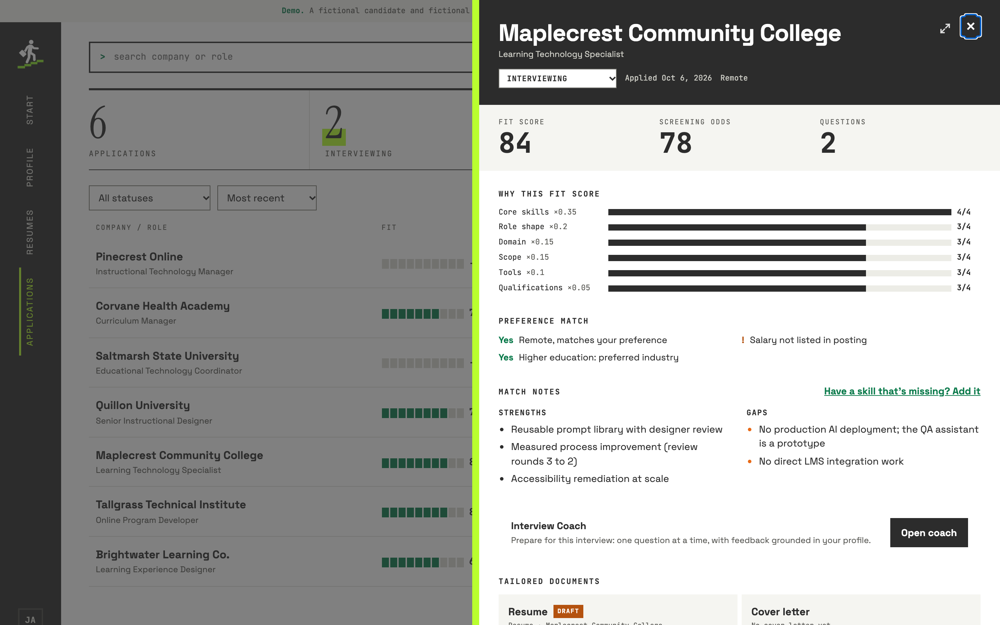
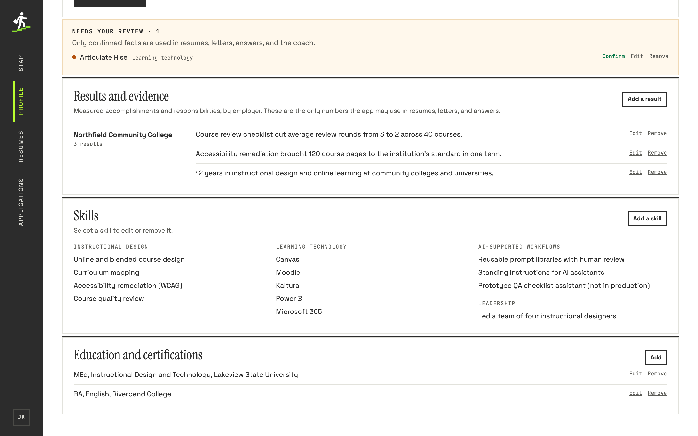

# Career Studio

A private job-search workspace that uses AI to tailor applications, with the
guardrails enforced in code.

Upload a resume or enter your skills, review a posting for fit, generate a
tailored resume and cover letter, draft application answers within the
character limit, and practice the interview one question at a time. Every
claim the AI writes must trace to a fact you confirmed; anything it can't
trace is flagged for you.

**Live demo:** https://career-studio-theta.vercel.app (a fictional candidate;
real records sit behind a private sign-in).
**Case study:** [docs/CASE_STUDY.md](docs/CASE_STUDY.md)


## Features

| | |
|---|---|
| **Profile** | Upload a PDF or Word resume and tick which extracted facts are true, or build a resume from skills. Unconfirmed items wait in a review queue. |
| **Job review** | Paste a posting or a link: fit score with a six-part breakdown, screening odds, strengths, gaps, and a preference match. |
| **Documents** | Tailored resume and cover letter, edited in place, downloaded as PDF or Word. Marking one as sent locks it. |
| **Answers** | Drafted from your facts and the posting, always within the character limit. |
| **Interview coach** | Prep, then one question at a time with feedback, a stronger answer, and a follow-up. |
| **Tracking** | Six statuses, a timeline, and a fictional public demo. |

| Job panel | Interview coach | Profile |
|---|---|---|
|  |  |  |

## Guardrails (in code, not just prompts)

- **Only confirmed facts** are ever sent to the model.
- **No invented numbers:** any figure in AI output must appear in your confirmed facts, or it is flagged.
- **Scores are computed in code** from six model-rated dimensions, so they are explainable.
- **One interview question at a time**, enforced by a server-side state machine.
- **Sent documents are frozen** by a database trigger.
- **Untrusted text is data:** postings, uploads, and answers can't instruct the model (covered by evals).
- **Spending caps** in the Anthropic Console and in the app, recorded through an insert-only function.
- **Private by default:** row-level security on every table and file, a fictional public demo, and a privacy scanner that blocks secrets, contact details, and private names from being committed.

## Run it locally

Requires Node 20+.

```bash
npm install
npm run dev        # http://localhost:4173 (the demo; sign in for live data)
npm test           # 85 unit and fixture tests
npm run check      # privacy guard
npm run check:rls  # live row-level security test (needs .env; see .env.example)
npm run eval       # live AI evals on a fictional profile (costs a few cents)
```

## How it's built

- `public/`: plain HTML, CSS, and JavaScript, no build step. `js/data.js` is the only module that knows whether data comes from the demo or the API.
- `api/`: Vercel functions. Every handler checks the signed-in owner and talks to Supabase with the owner's own token, so row-level security always applies.
  - `_lib/ai/`: provider adapter (Claude now; an OpenAI stub shares the interface).
  - `_lib/prompts.js`: prompts and strict JSON schemas.
  - `_lib/coach/machine.js`: the coach's turn order.
  - `public/js/checks.js`: the writing checks, shared by the server and the editor.
- `supabase/migrations/`: schema, row-level security, triggers, and the private Storage bucket.
- `evals/`: live checks for prompt injection, fabrication, limits, and coaching.
- `scripts/`: local dev server, privacy scanner, RLS test, and importers.

Built with Claude Code.
