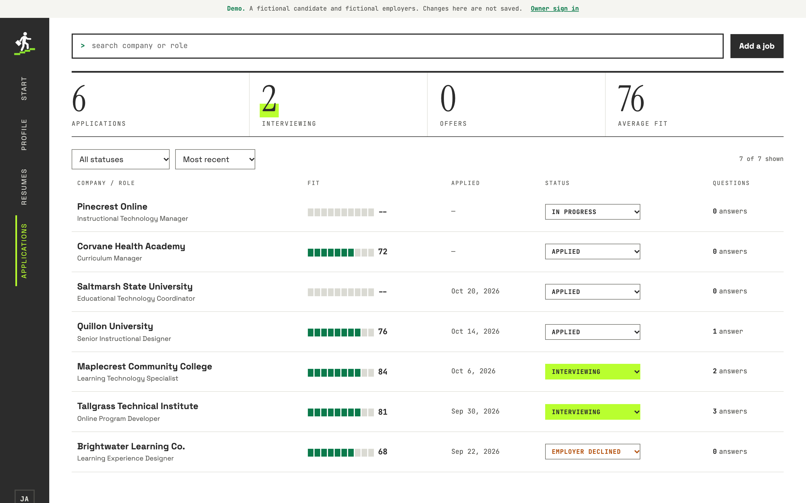
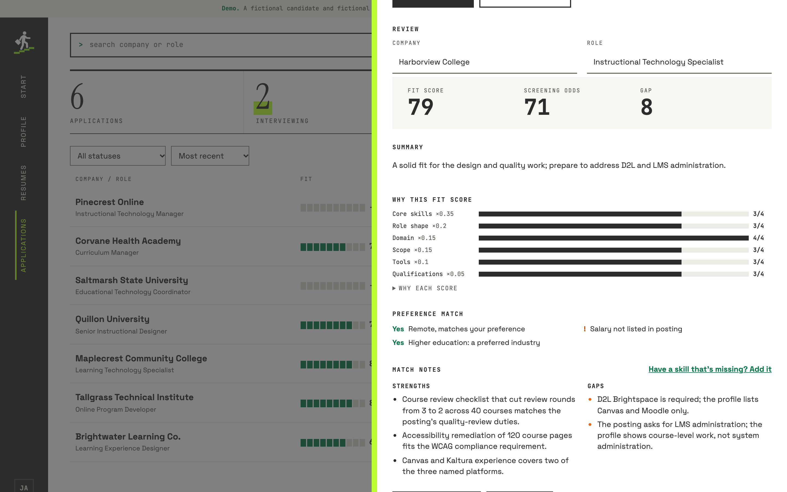
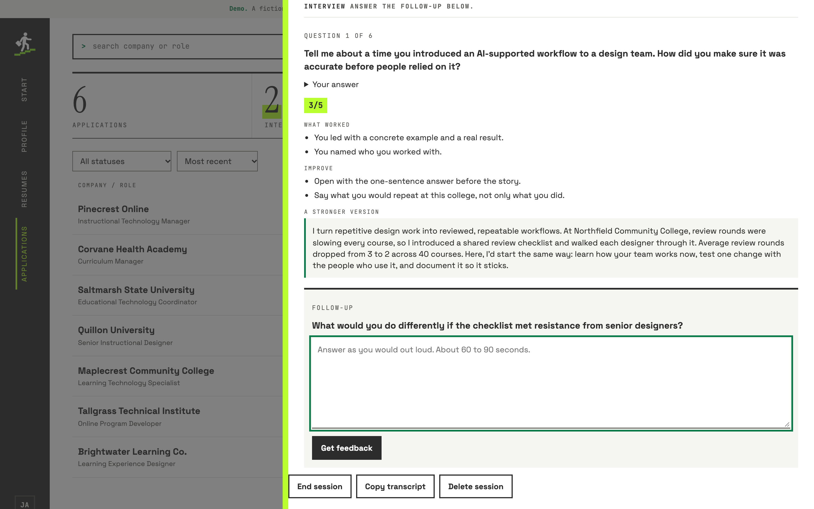

# Case study: Career Studio

*A private job-search workspace that uses AI to tailor applications, with
guardrails that live in code instead of in prompt wording.*

## The problem

A focused job search produces dozens of tailored resumes, cover letters, and
application answers. Doing that by hand is slow; doing it with a general AI
chat is fast but risky. Models round numbers up, invent tools, and turn a
prototype into a "launched platform". One fabricated metric in an
application can cost an interview.

The goal was a tool that makes tailoring fast **and** keeps every claim
traceable to something the candidate confirmed.

## What it does

| Area | What the owner can do |
|---|---|
| Profile | Upload a resume (PDF or Word) and tick which extracted facts are true, or enter skills and build a resume. Every fact is either confirmed or waiting in a review queue. |
| Job review | Paste a posting or a link. Get a fit score with a six-part breakdown, screening odds, strengths, gaps, and a separate preference match (salary, arrangement, industry, level). |
| Documents | Generate a tailored resume and cover letter, edit them in place, download PDF or Word, and mark a version as sent, which locks it. |
| Application questions | Draft answers that always fit the form's character limit. |
| Interview coach | Prep (hiring priorities, the likely concern, STAR stories), then one question at a time with feedback, a stronger answer, and one follow-up. |
| Tracking | Six application statuses, a timeline, and a public demo with a fictional candidate. |

## Design decisions

**Single owner, built for more.** Sign-in is a magic link to one allowlisted
email, and new sign-ups are disabled. Every table still carries a `user_id`
with row-level security, so opening it to other users later is a policy
change, not a rewrite.

**The model never decides the score.** The AI rates six dimensions from 0 to
4 with a reason for each; the fit score, screening odds, and preference
match are computed in code. Scores are explainable and reproducible.

**Two models by task.** Claude Opus writes resumes and cover letters, where
quality matters most. Claude Sonnet does scoring, extraction, answers, and
coaching, at roughly half the cost. Both sit behind a small provider adapter
(an OpenAI stub shares the interface).

**Structured output everywhere.** Every AI call passes a strict JSON schema
and gets data back, never free text to parse. Documents are stored as
structure and rendered into a locked, single-column, table-free layout, so the
editor, the PDF, and the Word file all come from one source.

**Plain HTML, CSS, and JavaScript.** No build step and three runtime
dependencies (the Anthropic SDK, `docx`, and `mammoth`). The UI talks to one
data module that can serve either the signed-in owner's live data or the
fictional demo.

## Guardrails in code

| Rule | How it is enforced |
|---|---|
| Only confirmed facts are used | Unconfirmed facts are never sent to the model. Uploads and edits land in a review queue. |
| No invented numbers | Every number in AI output must appear in the confirmed facts (or the posting, for reviews); otherwise it is flagged for the owner, never silently fixed. |
| No unheld titles, filler, or dashes | Checked on every draft, on the server and again in the browser while editing. |
| Postings and uploads are data | Untrusted text is wrapped in tags and declared to be data; evals plant instructions in postings and answers to confirm they are ignored. |
| Character limits | An over-limit answer is sent back to be shortened (twice at most), then trimmed at a sentence boundary and flagged. |
| One interview question at a time | A server-side state machine with conditional updates: skipping a follow-up, or a second window, gets a 409 before any money is spent. |
| Sent documents are frozen | A database trigger refuses edits to a sent document; editing makes a copy. |
| Spending | A monthly cap in the Anthropic Console, plus the app's own lower cap and daily call limit, recorded through an insert-only database function so the budget can't be reset from a browser. |
| Links are fetched safely | https only, every redirect re-checked against private and loopback addresses, with size and time limits. |
| Privacy | A scanner blocks secrets, contact details, and a private watch list of names and figures from ever being committed. |

## How it was verified

- **82 automated tests**, including fake-Claude tests for the shorten loop,
  the coach's turn order, and the numeric guard.
- **A live row-level-security test** (55 checks) that plants canary rows and
  private files, then confirms an anonymous visitor and a second account can
  read, change, delete, list, sign, or upload nothing.
- **Live evals** on a fictional profile: prompt injection in a posting and in
  an interview answer, a posting that demands metrics the candidate lacks, an
  unrelated job, and a hard character limit. A full run costs a few cents.
- **Accessibility**: an automated contrast audit of every screen at desktop
  and phone width (WCAG AA), visible focus states, and status shown in words,
  not color alone.
- **A real-data trial** before each release: each AI feature was run once on
  the owner's actual profile and read line by line against the source resume.

## What went wrong, and how it was caught

Honest notes, because the guardrails are only as good as the process around
them.

- **A failed check was hidden by a pipe.** A release command piped the
  privacy check through `tail`, so a failure didn't stop the push. A real
  employer name reached the private repo. Fix: every release now runs with
  `pipefail`, and a later release was correctly stopped by the same check.
- **Sample data that wasn't sample data.** A real salary figure was used as a
  test value. A full-history audit (scanning every file in every commit, not
  just the current tree) found it. The history was rewritten, verified from a
  fresh clone, and the figure added to the watch list.
- **The scanner can only find what it knows.** The first history scan came
  back clean because the watch list didn't yet include the salary. A second,
  broader search (name, location, contact details, figures) found it. Lesson:
  a clean scan proves only that the listed terms are absent.
- **Concurrent token refreshes signed the owner out.** Refresh tokens are
  single-use; several requests renewing at once could invalidate the session.
  Fix: one shared renewal, sign-out only on a definitive rejection, one retry.
- **A setting that didn't stick.** Supabase sign-ups were meant to be off and
  weren't; the release audit read the live setting and caught it.

## What the AI does, and doesn't do

**Does:** read postings and resumes, score six dimensions with reasons, draft
resumes, letters, answers, and coaching feedback, and suggest new facts the
owner mentioned.

**Doesn't:** decide scores, confirm facts, change anything already sent, see
unconfirmed facts, or act on instructions found in postings, uploads, or
answers. Every claim it writes traces to something the owner confirmed, and
anything it can't trace is flagged for a human.

## Stack

Vercel (static site and serverless functions), Supabase (Postgres with
row-level security, Auth, private Storage), Claude Opus and Sonnet through the
Anthropic SDK, `docx` for Word export, `mammoth` for reading Word uploads.
Built with Claude Code.
